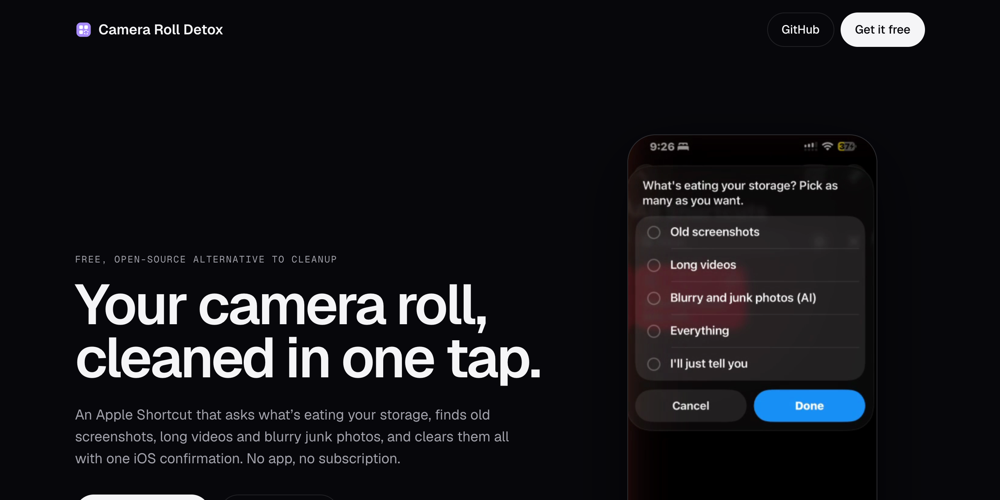
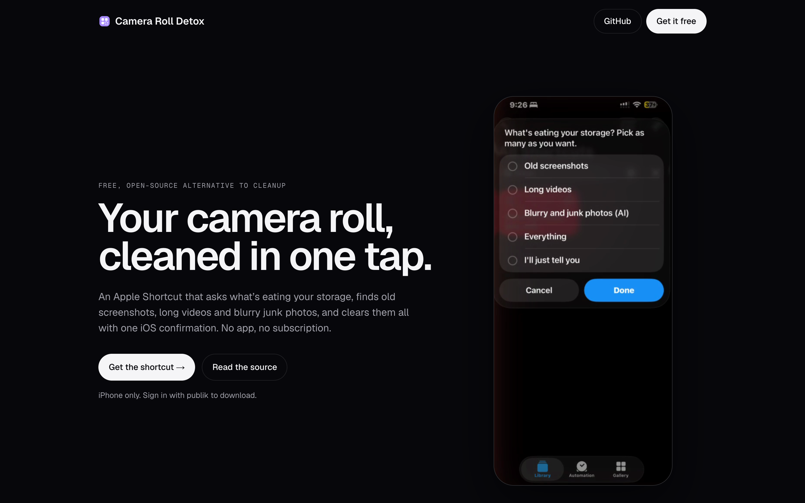
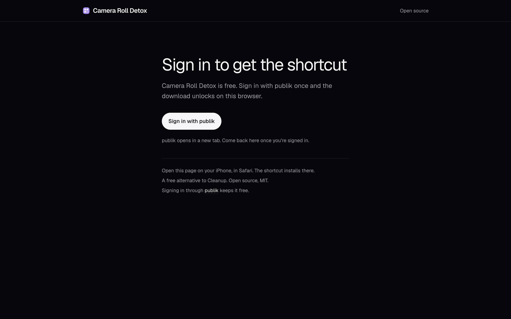
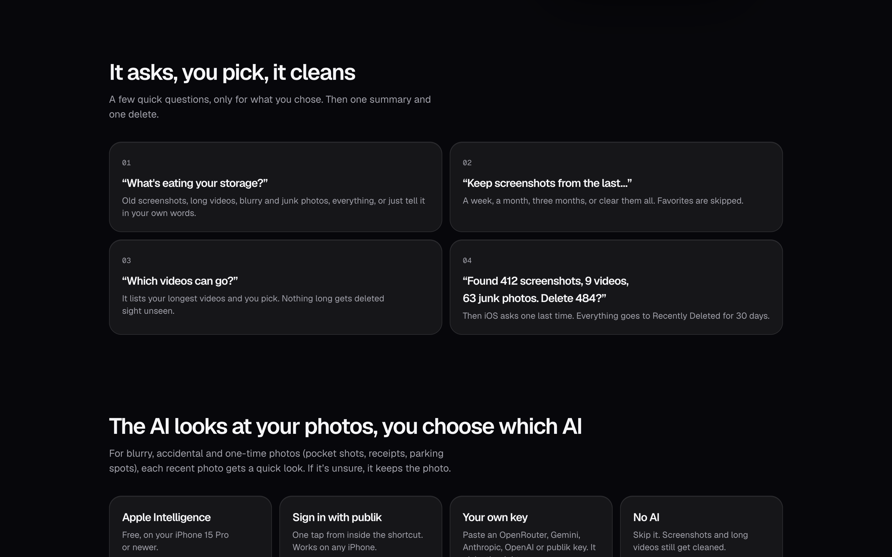
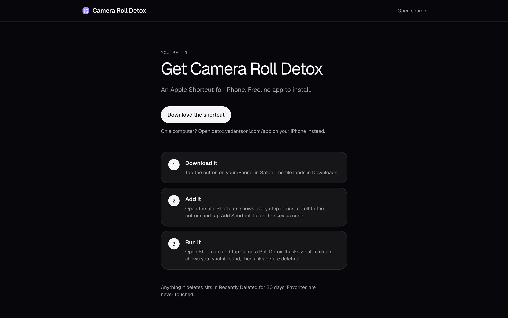

<div align="center">



# Camera Roll Detox

**Clean your iPhone camera roll with AI in one tap, free**

[**Get it →**](https://detox.vedantsoni.com) &nbsp;·&nbsp; [Watch the demo](docs/media/demo.mp4) &nbsp;·&nbsp; [Report a bug](https://github.com/VedSoni-dev/detox/issues)

[](LICENSE)
[](https://detox.vedantsoni.com)
[](https://github.com/VedSoni-dev/detox/stargazers)

</div>

An Apple Shortcut for iPhone, and the small site that hands it out. A free, open-source alternative to Cleanup
(not affiliated): no app to install, no subscription.

## What it does

- Asks what's eating your storage: old screenshots, long videos, blurry and junk photos, everything, or just tell it in your own words.
- Finds screenshots older than the age you pick and the videos longer than the length you pick. Favorites are skipped; you pick which long videos go.
- Has AI look at your recent photos and flag the blurry, accidental and one-time ones (pocket shots, receipts, parking spots). If it's unsure, it keeps the photo.
- Shows what it found ("Found 412 screenshots, 9 videos, 63 junk photos. Delete 484?"), lets you untick anything, then deletes it all with one iOS confirmation. Everything stays in Recently Deleted for 30 days.

## Pick the AI

| Option | How | Works on |
|---|---|---|
| **Apple Intelligence** | Free, built into the phone | iPhone 15 Pro or newer |
| **Sign in with publik** | One tap inside the shortcut; your phone gets its own key | any iPhone |
| **Your own key** | Pick Gemini, Claude, OpenAI or OpenRouter from the menu, then paste that key once (saved on the phone) | any iPhone |
| **No AI** | Skip it; screenshots and long videos still get cleaned | any iPhone |

With Apple Intelligence nothing leaves Apple. With publik or a key, a 512px JPEG of each checked photo goes to that
service only. Screenshots and videos are found on the phone with no AI.

## Get it

Open [detox.vedantsoni.com](https://detox.vedantsoni.com) on your iPhone, sign in with publik, tap **Download the
shortcut**, open the file and tap **Add Shortcut** at the bottom.

## Build it yourself

The shortcut is generated, not hand-made. On a Mac signed in to iCloud:

```bash
git clone https://github.com/VedSoni-dev/detox.git
cd detox/shortcut
python3 build.py              # dist/Camera Roll Detox.shortcut + a dry-run copy that never deletes
python3 build.py --anyone     # signed so anyone can open it (needs free iCloud space)
```

The site: `npm install && npm run dev`, then open http://localhost:3000. Node 20.9 or newer.

## Screenshots

<table>
  <tr>
    <td></td>
    <td></td>
  </tr>
  <tr>
    <td></td>
    <td></td>
  </tr>
</table>

## How it works

`shortcut/build.py` writes the shortcut as a plist (action IDs and parameter keys read from macOS's own Shortcuts
action database) and signs it with `shortcuts sign`. Find Photos does the screenshot and video searches; the AI check
resizes each photo and asks the chosen model for one word, JUNK or KEEP. The site is a Next.js app: the landing is
open, the download sits behind Sign in with publik through the builds hub, checked again on the server.

| Path | What |
|---|---|
| `shortcut/build.py` | Generates and signs the shortcut |
| `app/page.tsx` | The landing page |
| `app/app/` + `components/Gate.tsx` | Sign in with publik, then the download page |
| `app/api/download/route.ts` | Serves the file to signed-in browsers only |
| `kit/` | Shared studio kit (publik sign-in, theme, motion) |

**Privacy.** The site keeps your publik sign-in in an encrypted, http-only cookie and sends an anonymous usage count to
[Vedant's builds hub](https://builds.vedantsoni.com) (this app's name, a random id per browser; no content, no IP, no
account), never for browsers with Do Not Track or Global Privacy Control. The shortcut saves a publik key, if you sign
in, to its own file in your Shortcuts folder.

## License

[MIT](LICENSE) © Vedant Soni

<div align="center">
<sub>Built in public by <a href="https://instagram.com/vedanttalksai">@vedanttalksai</a>. More builds at <a href="https://vedantsoni.com">vedantsoni.com</a>.</sub>
</div>
